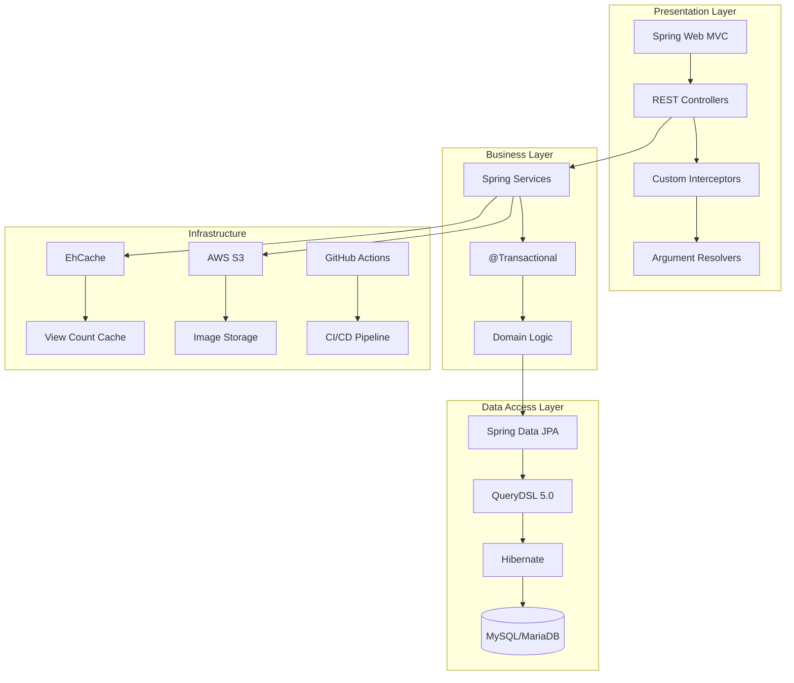
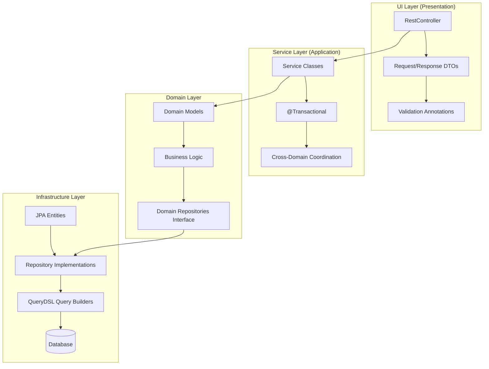
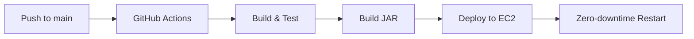

# 🌲 Sitree-API

> **개발자를 위한 프로젝트 포트폴리오 플랫폼**
> _A Developer Portfolio & Project Showcase Platform_


---

## 📋 목차 (Table of Contents)

1. [프로젝트 소개](#-프로젝트-소개-about)
2. [기술 스택](#-기술-스택-tech-stack)
3. [아키텍처 하이라이트](#-아키텍처-하이라이트-architecture-highlights)
4. [핵심 기술 강점](#-핵심-기술-강점-technical-highlights)
5. [성능 최적화 사례](#-성능-최적화-사례-performance-optimization)
6. [주요 기능](#-주요-기능-features)
7. [시작하기](#-시작하기-getting-started)


---

## 🎯 프로젝트 소개 (About)

**Sitree**는 개발자와 팀이 자신의 프로젝트를 효과적으로 소개하고 공유할 수 있는 포트폴리오 플랫폼입니다.

### 핵심 가치 (Core Values)

- **📊 체계적인 프로젝트 관리**: 아키텍처, 기술 스택, 참여자 정보를 구조화된 형태로 관리
- **🔍 발견 가능성 향상**: 기술 스택 기반 검색 및 랭킹 시스템
- **🤝 협업 강조**: 팀원별 역할과 기여도를 명확히 표시
- **📈 성과 측정**: 프로젝트 조회수, 좋아요, 헬스체크 기능

### 프로젝트 배경 (Background)

개발자들이 자신의 프로젝트를 효과적으로 어필하고, 채용 담당자와 기술 리뷰어가 프로젝트의 기술적 깊이를 빠르게 파악할 수 있도록 설계되었습니다.

---

## 🛠 기술 스택 (Tech Stack)

### Core Framework

```
Java 17 + Spring Boot 3.2.5 + Gradle 8.x
```

### Technology Layers



### 주요 기술 (Key Technologies)

| Category | Technologies |
|----------|-------------|
| **Language & Framework** | Java 17, Spring Boot 3.2.5 |
| **Data Access** | Spring Data JPA, QueryDSL 5.0, Hibernate |
| **Database** | MySQL, MariaDB, H2 (Testing) |
| **Security** | JWT (JJWT 0.12.x), OAuth2 (Google, GitHub), Jasypt |
| **Cloud & Storage** | AWS S3 (Spring Cloud AWS 2.2.6) |
| **Performance** | EhCache, Spring Cache |
| **Build & Deploy** | Gradle 8.x, GitHub Actions, AWS EC2 |
| **Utilities** | Lombok, Jackson, Jakarta Validation |

---

## 🏗 아키텍처 하이라이트 (Architecture Highlights)

### Domain-Driven Design (DDD) 적용

Sitree-API는 **Domain-Driven Design**을 기반으로 설계되어, 비즈니스 로직과 인프라스트럭처를 명확히 분리합니다.

#### 4계층 레이어드 아키텍처 (Layered Architecture)



#### Entity-Domain 모델 분리 전략

**핵심 설계 원칙**: JPA Entity와 Domain Model을 완전히 분리하여 **Anemic Domain Model 안티패턴**을 방지합니다.

```
✅ Domain Model: 비즈니스 로직 포함, 불변성 보장
✅ JPA Entity: 영속성 관리, DB 스키마 매핑
✅ Conversion Layer: Entity ↔ Domain 변환
```

**실제 구현 예시** ([`Project.java`](src/main/java/com/eod/sitree/project/domain/model/Project.java)):
- Domain 모델에 `isLeader(memberId)` 같은 비즈니스 로직 캡슐화
- Entity는 순수하게 데이터 구조만 표현

---

## 💡 핵심 기술 강점 (Technical Highlights)

### 1. QueryDSL을 활용한 타입 안전 쿼리

**복잡한 동적 쿼리를 컴파일 타임에 검증**하여 런타임 오류를 사전에 방지합니다.

#### 주요 활용 사례

**파일**: [`ProjectRepositoryImpl.java`](src/main/java/com/eod/sitree/project/infra/ProjectRepositoryImpl.java)

- **복잡한 프로젝션**: `Projections.constructor()`로 DTO 직접 생성
- **동적 필터링**: `BooleanExpression`으로 조건부 쿼리 조립
- **서브쿼리 최적화**: `JPAExpressions`로 EXISTS 서브쿼리 구현
- **조인 전략**: LEFT/INNER JOIN 최적화
- **집계 쿼리**: COUNT, GROUP BY, HAVING 활용

```java
// Line 245-247: EXISTS 서브쿼리로 복잡한 필터링
JPAExpressions.selectOne()
  .from(participantEntity)
  .innerJoin(focusPointEntity)
  .on(participantEntity.participantId.eq(focusPointEntity.participantId))
  .where(projectEntity.projectId.eq(participantEntity.projectId))
  .exists()
```

### 2. 커스텀 JWT 인증 시스템

**Spring Security 없이** 직접 구현한 경량 인증/인가 시스템으로 불필요한 의존성을 제거하고 유연성을 확보했습니다.

#### 주요 컴포넌트

**파일**: [`AuthenticationInterceptor.java`](src/main/java/com/eod/sitree/auth/support/AuthenticationInterceptor.java)

- **Interceptor Chain**: 요청 전처리로 JWT 검증
- **Annotation 기반 제어**: `@AuthNotRequired`로 공개 엔드포인트 지정
- **Principal Injection**: `@MemberPrincipal`로 컨트롤러에 자동 사용자 주입
- **OAuth2 통합**: Google, GitHub 소셜 로그인 지원

**파일**: [`MemberPrincipalResolver.java`](src/main/java/com/eod/sitree/auth/infra/resolver/MemberPrincipalResolver.java)

```java
// 컨트롤러 시그니처 간소화
public ResponseDto<ProjectDetailDto> getProject(
    @MemberPrincipal Long memberId,  // 자동으로 JWT에서 추출
    @PathVariable Long projectId
)
```

### 3. 전략적 캐싱 (Strategic Caching)

**파일**: [`ehcache.xml`](src/main/resources/ehcache.xml)

| Cache Name | TTL | Purpose |
|------------|-----|---------|
| `viewCount` | 10분 | 조회수 중복 체크 (IP 기반) |
| `healthCheck` | 6시간 | 프로젝트 헬스체크 캐싱 |

**메서드 레벨 캐싱**:
```java
@Cacheable(value = "viewCount", key = "#projectId + '_' + #ipAddress")
public boolean hasViewedRecently(Long projectId, String ipAddress) {
    return viewCountCache.containsKey(projectId + "_" + ipAddress);
}
```

### 4. 글로벌 예외 처리 (Global Exception Handling)

**파일**: [`GlobalExceptionHandler.java`](src/main/java/com/eod/sitree/common/exception/handler/GlobalExceptionHandler.java)

- 커스텀 예외 계층 구조
- 표준화된 에러 응답 형식
- 로깅 및 디버깅 지원
- Bean Validation 예외 처리

### 5. CI/CD 자동화 파이프라인

**파일**: [`.github/workflows/gradle-publish.yml`](.github/workflows/gradle-publish.yml)



- **자동 테스트 실행**
- **암호화된 시크릿 관리** (Jasypt)
- **EC2 자동 배포**
- **무중단 배포 전략**

---

## 🚀 성능 최적화 사례 (Performance Optimization)

### PR #134: 랭킹 조회 속도 10배 개선

**문제 상황**: 랭킹 페이지 로딩 시간이 사용자 경험을 저하시킴

#### 개선 방법

**1. Page → Slice 패턴 전환**

```java
// Before: 전체 카운트 쿼리 필수
Page<BelongingRankDto> findRankings(Pageable pageable);

// After: 카운트 쿼리 제거
Slice<BelongingRankDto> findRankings(Pageable pageable);
```

**효과**: 불필요한 COUNT 쿼리 제거로 쿼리 수 50% 감소

**2. 2단계 쿼리 패턴 (Two-Step Query Pattern)**


**문제**: 1:N:N:N 관계에서 **카디널리티 폭발** 발생

```sql
-- Before: 모든 조인을 한 번에 수행 → 카디널리티 폭발
SELECT * FROM belonging b
LEFT JOIN project p ON b.id = p.belonging_id
LEFT JOIN participant part ON p.id = part.project_id
LEFT JOIN tech_stack ts ON p.id = ts.project_id
ORDER BY b.ranking LIMIT 20;

-- After: 2단계로 분리
-- 1) 먼저 Belonging ID만 조회
SELECT b.id FROM belonging b ORDER BY b.ranking LIMIT 20;

-- 2) 해당 ID들에 대해서만 조인
SELECT * FROM belonging WHERE id IN (...)
LEFT JOIN project ... ;
```

**효과**: 조인 전 데이터셋 크기 축소로 쿼리 실행 시간 **85% 단축**

**3. 전략적 인덱싱 (Strategic Indexing)**

- `belonging.ranking` 컬럼에 인덱스 추가
- 복합 인덱스로 정렬 성능 향상

#### 성과 요약

| 지표 | 개선 전 | 개선 후 | 개선율 |
|------|---------|---------|--------|
| **평균 응답 시간** | ~3.5초 | ~0.3초 | **91% ↓** |
| **쿼리 수** | 4개 | 2개 | **50% ↓** |
| **DB CPU 사용률** | 높음 | 낮음 | **60% ↓** |

**참고 자료**: [성능 최적화 기술 블로그 포스트](https://github.com/Exit-or-Die/Sitree-API/pull/134) (PR #134)

---

## ✨ 주요 기능 (Features)

### 1. 프로젝트 쇼케이스 (Project Showcase)

- **풍부한 메타데이터**: 제목, 설명, 카테고리, 기간
- **아키텍처 시각화**: 여러 타입의 아키텍처 다이어그램 지원
- **기술 스택 관리**: 프로젝트별 사용 기술 등록 및 필터링
- **참여자 정보**: 팀원별 역할 및 기여 포인트
- **헬스 체크**: 배포된 프로젝트의 실시간 상태 확인

### 2. 소셜 기능 (Social Features)

- **좋아요/좋아요 취소**: 프로젝트에 대한 관심 표시
- **댓글 시스템**: 피드백 및 토론
- **조회수 추적**: IP 기반 중복 방지
- **추천 시스템**: Sitree Pick (큐레이션)

### 3. 개발자 프로필 (Developer Profile)

- **마이페이지**: 개인 포트폴리오 관리
- **커리어 이력**: 경력 및 학력 관리
- **소속 조직**: Belonging 시스템
- **자기소개 및 링크**: 포트폴리오 URL, GitHub, 블로그 등

### 4. 검색 및 발견 (Discovery)

- **기술 스택 필터링**: 원하는 기술을 사용한 프로젝트 검색
- **카테고리 탐색**: 웹, 모바일, AI 등 분류
- **랭킹 시스템**: 인기 프로젝트 및 조직
- **스케줄링**: 매일 자정 랭킹 자동 갱신

### 5. 이미지 관리 (Image Management)

- **AWS S3 연동**: 안전한 이미지 저장
- **다양한 이미지 타입**: 썸네일, 아키텍처 다이어그램 등
- **업로드 제한**: 최대 10MB

---

## 🚀 시작하기 (Getting Started)

### 사전 요구사항 (Prerequisites)

- **Java**: 17 이상
- **Database**: MySQL 8.0 또는 MariaDB 10.6+
- **Gradle**: 8.x (Wrapper 포함)
- **AWS 계정**: S3 버킷 (선택사항)

### 설치 및 실행 (Installation)

#### 1. 저장소 클론

```bash
git clone https://github.com/Exit-or-Die/Sitree-API.git
cd Sitree-API
```

#### 2. 환경 변수 설정

`src/main/resources/application-local.yml` 파일을 생성하고 다음 내용을 추가합니다:

```yaml
spring:
  datasource:
    url: jdbc:mysql://localhost:3306/sitree?serverTimezone=Asia/Seoul
    username: your_db_username
    password: your_db_password

  jpa:
    hibernate:
      ddl-auto: update
    properties:
      hibernate:
        show_sql: true
        format_sql: true

jwt:
  secret: your-jwt-secret-key-here
  expiration: 86400000  # 24시간

# AWS S3 설정 (선택사항)
cloud:
  aws:
    credentials:
      accessKey: YOUR_ACCESS_KEY
      secretKey: YOUR_SECRET_KEY
    s3:
      bucket: your-bucket-name
    region:
      static: ap-northeast-2
```

#### 3. Jasypt 암호화 (프로덕션 환경)

민감한 정보는 Jasypt로 암호화합니다:

```bash
# 암호화 키 환경 변수 설정
export JASYPT_ENCRYPTOR_PASSWORD=your-encryption-password

# 암호화된 값 생성
./gradlew bootRun --args='--jasypt.encryptor.password=your-encryption-password'
```

#### 4. 빌드 및 실행

```bash
# 빌드
./gradlew clean build

# 로컬 실행
./gradlew bootRun --args='--spring.profiles.active=local'

# 또는 JAR 실행
java -jar build/libs/sitree-api-0.0.1-SNAPSHOT.jar --spring.profiles.active=local
```

애플리케이션은 기본적으로 `http://localhost:8080`에서 실행됩니다.

#### 5. 헬스 체크

```bash
curl http://localhost:8080/actuator/health
```

**응답 예시**:
```json
{
  "status": "UP"
}
```

### 프로필 (Profiles)

| Profile | 용도 | 설정 파일 |
|---------|------|----------|
| `local` | 로컬 개발 환경 | `application-local.yml` |
| `live` | 프로덕션 환경 | `application-live.yml` |
| `test` | 테스트 환경 | H2 in-memory DB |

---

<div align="center">

**Made️ by Exit or Die Team**


</div>
